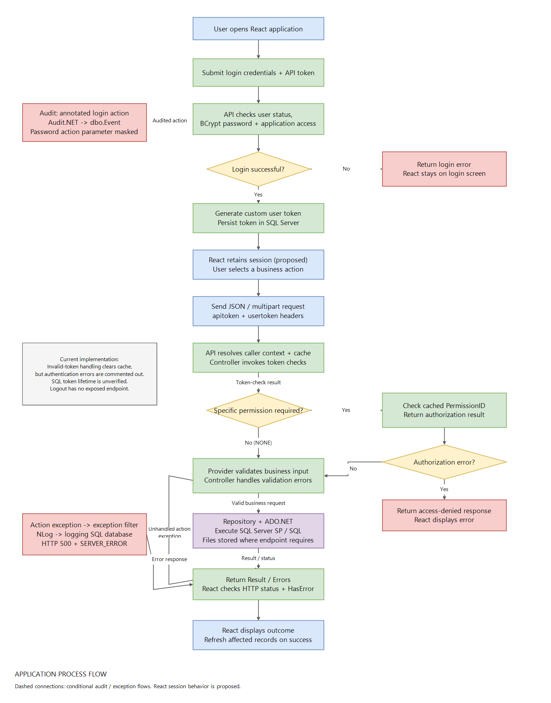

# Application Process Flow
Version 1.0 | Prepared: 6 October 2026 | Scope: React frontend, .NET 8 API, SQL Server

## 1. Purpose and implementation scope
This document explains how users interact with the application through a React application and how the API processes their requests. It covers authentication, authorization, token management, business operations, database access, file storage, audit, and application logging.

Backend behavior is based on the source in this repository. No React source or package.json was found. Frontend screens, navigation, session storage, request cancellation, and UI behavior described below are proposed integration behavior, not verified features. SQL stored-procedure implementations, hosting topology, and production deployment settings were not available.

Related diagrams: [Architecture](FINOVA-Architecture.drawio), [Detailed data flow](FINOVA-Data-Flow.drawio), and [Overview XML](FINOVA-Data-Flow.xml).

## 2. Application components and responsibilities
| Component | Responsibility |
| --- | --- |
| React frontend | Present login and business screens; capture inputs; send API requests; display results and errors. Proposed integration layer. |
| API | Route HTTP requests, bind input models, resolve caller context, invoke security checks, execute controllers, and return responses. |
| Provider | Verify credentials, validate business input, coordinate operations, and call repositories. |
| Repository | Build database commands and parameters; map SQL results to application models. |
| Database | Execute stored procedures, SQL commands, and bulk operations through System.Data.SqlClient / ADO.NET. |
| DataModel | Request/response DTOs, entities, enums, and caller-context interfaces. |
| Commonlib | Shared utilities, security helpers, and in-process memory caching. |
| Configuration | Application settings, connection settings, and file-upload paths. |
| Logging | Build structured NLog events for explicit application logging and action exceptions. |
| SQL Server application database | Store application records and token/identity data; execute business procedures; receive Audit.NET events in dbo.Event. |
| SQL Server logging database | Receive structured NLog events through dbo.usp_Log_add. |
| Server file storage | Persist uploaded documents and images. |

## 3. Overall process
User action -> React input checks -> HTTP request -> API middleware and caller context -> controller security checks -> provider business processing -> repository -> ADO.NET -> SQL Server -> result mapping -> controller response -> React updates the screen.

Audit is attached to selected audited actions. Exception logging follows the configured controller exception-filter path. These are separate from ordinary business processing.

### Frontend request lifecycle (proposed)
1. Open the relevant screen and load any required master data.
2. Collect user input and perform immediate field validation.
3. Construct the endpoint-specific JSON payload or FormData.
4. Attach apitoken and, after login, usertoken as request headers.
5. Show a pending state and prevent accidental repeated submission.
6. Send the HTTP request using the configured API base URL.
7. Check the HTTP status and the returned application error envelope.
8. Render returned data, show validation errors, or present an operation failure.
9. Reload affected lists/details after a confirmed successful write.

Token-storage technology and frontend hosting are deliberately unspecified. The integration must choose them before implementation. Do not put tokens in request URLs: the backend supports query-string fallback, but headers are the proposed frontend contract.

## 4. Startup and request context
### Backend startup
1. Initialize ApplicationConfiguration from application configuration.
2. Register controllers, JSON options, CORS, logging, caller context, memory cache, and Swagger.
3. Configure Audit.NET SqlDataProvider using FIADB and dbo.Event.
4. Initialize MemoryCachingService with the registered IMemoryCache.
5. Configure static files, routing, CORS, custom caller-context middleware, and controller endpoints.
6. Start the application.

The current CORS policy permits any origin, method, and header. A deployment-specific frontend origin policy is not documented here.

### Per-request context
1. Read apitoken and usertoken from headers; fall back to query parameters when absent.
2. Try cached application/user details and user identifiers.
3. On a cache miss or incomplete identity, call AuthenticationProvider.GetApplicationAndUserDetails.
4. AuthenticationRepository executes AAC.usp_GetApplicationAndUserDetails.
5. Populate IServiceUser with application, organization, user, URL, headers, referrer, and IP information where identity details are available.
6. Load and cache user/application permissions when needed.
7. Continue to the controller.

The cache is local to each API process. Entries have a 15-minute absolute lifetime. This cache duration is not the SQL token lifetime. ClearAll currently performs no cache clearing.

## 5. Authentication: login
### Frontend interaction (proposed)
Display a username/password form, submit POST /AA/Login with an apitoken header, show a pending state, and process the returned login envelope. On success, retain UserToken according to the chosen frontend session design and display DisplayName. On failure, show the returned error and remain on the login screen.

### Verified backend sequence
1. AAController.Login receives UserLoginRequest.
2. Invoke AuthenticateAndAuthorize(CallerUser, false). The login flow requests API-token checking without requiring a user token, unless a user token is supplied.
3. AuthenticationProvider.Login loads user details through AAC.usp_GetUserDetails.
4. Reject an unknown user or a user whose status is not Activated.
5. Compare the submitted password to the stored hash with BCrypt.Verify.
6. Verify application access through AAC.usp_ValidationApplicationPermissions.
7. Generate a GUID and transform it with BCrypt.HashString to create a custom user token.
8. Persist the token through AAC.usp_CreateUserToken with user ID, API token, and IP information.
9. Return UserToken and DisplayName, or an application error.

AAController returns HTTP 200 for its login response envelope, including application-level login failures. React must inspect HasError rather than interpreting HTTP 200 alone as successful authentication.

## 6. Token management
| Stage | Verified behavior |
| --- | --- |
| API token | Supplied by the caller and checked through SQL. Its provisioning process is not established by the inspected login flow. |
| User-token creation | AuthenticationProvider generates a GUID-based BCrypt token after successful credential and application-access checks. |
| Persistence | AAC.usp_CreateUserToken receives the generated token and caller information. |
| Request use | Frontend should send apitoken and usertoken headers on protected operations. |
| Verification | AAC.usp_VerifyUserToken receives both tokens, validateBothToken, and slidingExpiration. |
| Sliding expiration | The helper defaults slidingExpiration to true; SQL expiry/extension rules are not available in the repository. |
| Expiration/logout support | AuthenticationProvider.Logout calls AAC.usp_ExpireUserToken through the repository. |
| Frontend logout | Proposed: expire the server session through an exposed logout operation, clear local session state, and return to login. No logout controller endpoint was found, so full server logout is not currently an established frontend integration. |

These tokens are not JWTs. No refresh-token endpoint or specific SQL token lifetime was verified.

Current implementation limit: missing/invalid-token branches in AuthenticationHelper clear cache but have AUTHENTICATION_FAILURE setting commented out. Consequently, the helper can return an ErrorResponse with no error for an invalid token. This is a gap in the existing process, not a guarantee that every protected request is rejected correctly.

## 7. Authorization
Authentication identifies/checks the caller. Authorization checks whether that caller may perform a particular operation.

1. Middleware/provider load permission records through AAC.usp_GetUserAccessPermissions using UserMasterID and ApplicationID.
2. Cache the records under USER_ROLES_API using application ID and user token.
3. A controller supplies a required permission to AuthenticateAndAuthorize or calls AuthorizationHelper directly.
4. If the permission is NONE, the helper skips specific permission evaluation.
5. Otherwise, AuthorizationHelper searches the cached list for the requested PermissionID.
6. Missing permissions or no matching record produce AUTHORIZATION_FAILURE.
7. The controller returns the relevant error or proceeds with the business operation.

AuthorizationHelper itself does not reload missing permissions. Many controllers pass the default permission NONE; explicit permission enforcement must be assessed endpoint by endpoint. UI visibility or a disabled button cannot substitute for server-side authorization.

KYC example: upload is allowed for the caller's own record or a user in the same organization. A different organization requires UPLOAD_KYC permission. This endpoint also performs an explicit caller/user-token presence check.

## 8. Business module process map
The following screen groups are proposed frontend mappings to existing controllers, not confirmed React routes.

| Proposed screen group | Existing API area | Typical process |
| --- | --- | --- |
| Login | AA | Verify credentials and create a session token. |
| Applications and setup | AppManager / Config | Load application settings and maintain configuration. |
| Organizations | OrgMgr | Load, create, update, or delete organization records. |
| Users and KYC | User / UserMgr | Maintain user information and attach documents. |
| Wallet and company accounts | Wallet | Maintain account and wallet-related records. |
| Transactions | Transaction | Submit transaction data for validation and database processing. |
| Reports and dashboard | Report | Submit filters and display returned reporting/dashboard data. |
| Notifications | Notification | Call available notification operations. |
| Master data | MasterData | Populate dropdowns and reference fields. |

### Standard read
React loads a screen -> sends filters/identifiers and tokens -> API resolves caller -> controller checks security -> provider calls repository -> SQL returns records -> repository maps records -> controller returns data -> React renders list/details or empty state.

### Standard create/update/delete
React validates inputs -> submits DTO and tokens -> controller checks security -> provider validates fields -> repository executes the operation -> SQL returns identifiers/status -> API returns Result or Errors -> React confirms only a successful result and refreshes affected data.

SQL atomicity, transaction isolation, and rollback behavior cannot be established without the stored-procedure definitions. Not every provider applies identical validation.

## 9. Transaction submission example
Endpoint: POST /Transaction/CreateNewTransaction, with a JSON NewTransactionRequest.

1. React collects transaction fields and validates required inputs.
2. Attach apitoken and usertoken and submit the request.
3. TransactionController invokes AuthenticateAndAuthorize(CallerUser, true).
4. TransactionProvider checks positive organization/user/service/agency identifiers, a positive amount, nonnegative fee/margin, and required partner transaction/type/platform strings.
5. Normalize relevant string values and pass the request to the repository.
6. Execute the database operation and map its result.
7. Return SimpleResponse.
8. React checks HasError and Result before showing confirmation.

This flow documents transaction record processing. It does not establish external bank/payment settlement, reconciliation, guaranteed idempotency, or automatic reversal. A frontend should not automatically retry an uncertain write until the operation's duplicate-handling contract is known.

## 10. File-upload processes
### Company-account attachment
Endpoint: POST /Wallet/CreateCompanyAccount, using multipart/form-data.

1. React sends account fields and an optional file.
2. Controller checks security and request presence.
3. If a file exists, check extension: PDF, JPG, JPEG, or PNG; maximum file size is 5 MB.
4. Generate a unique filename and save under wwwroot/uploads/company-account/{OrganizationId}.
5. Build its relative URL and pass it with account fields to WalletProvider.
6. Provider validates business data and repository writes through SQL.
7. React processes the response and refreshes account information.

File saving precedes provider validation/database persistence. A subsequent failure can leave an unattached file; the inspected flow does not provide a coordinated SQL/file rollback.

### User KYC upload
Endpoint: POST /UserMgr/UploadUserKycFile, using UserMasterID and File form fields.

1. Check caller identity/token and target user.
2. Apply own-user/same-organization access or require UPLOAD_KYC for other organizations.
3. Reject missing/empty files, invalid target IDs, or files larger than 10 MB. The request-size limit is 11 MB.
4. Check PDF/JPG/JPEG/PNG extension and matching file signature.
5. Save through FileManager under the configured PartnerDocument/{user ID} convention.
6. Return FileUrl, MediaExtension, and MediaContentType in Result.

The upload endpoint saves and returns file metadata; it does not itself persist a KYC database record. A subsequent attachment/record-save step must use the applicable API contract. React should not treat file upload alone as completed KYC processing.

## 11. Reports and dashboard
Examples: POST /Report/TransactionDetailsReport and POST /Report/AdminDashboard.

1. React collects the relevant report or dashboard filters.
2. Submit the endpoint-specific JSON request with tokens.
3. Controller invokes its security helper.
4. ReportProvider calls the repository and SQL reporting operation.
5. Return reporting data in the response.
6. React renders tables, totals, or an empty state after checking errors.

Export formats, interactive charts, pagination, and scheduled report delivery are not verified frontend features.

## 12. Audit process
Audit coverage observed: POST /AA/Login has AuditApi. The configured SQL audit provider alone does not establish auditing for every endpoint.

1. Audit.WebApi captures the annotated login action.
2. Its configuration includes headers and response body, and excludes request body/model state.
3. Program.cs runs OnEventSaving.
4. If the event action parameters contain userLoginRequest, replace its Password with ***NOT-LOGGED***.
5. Audit.SqlServer SqlDataProvider serializes the event into FIADB.dbo.Event.
6. The configured columns are EventId, Data, and LastUpdatedDate.

The named password mask is not general token/header redaction. Login headers and response data can contain tokens. The process should be understood with that current capture behavior.

## 13. Application logging and exception handling
1. An action exception reaches FINOVExceptionFilterService on controllers that register it.
2. Collect exception details and caller/request metadata, including URL, IP, referrer, headers, and tokens.
3. Call LoggingService.LogError.
4. Create an NLog LogEventInfo with structured properties.
5. The NLOG logger routes Info-and-higher events to the configured database target.
6. Execute dbo.usp_Log_add using the LoggingDB connection setting.
7. Return an HTTP 500 response containing SERVER_ERROR to the client.

LogMessage and LogWarning are available for explicit calls; ordinary successful API calls are not automatically logged through those methods.

NLog's own diagnostics are separate: internal warnings/errors are written to admin_logging_error.txt. That file is useful for logging-target/configuration failures and is not the application business-log database.

## 14. Frontend response and error handling
| Response condition | Proposed React handling |
| --- | --- |
| HTTP success and HasError=false | Render Result or login fields; verify endpoint-specific response shape. |
| HTTP success and HasError=true | Show Errors; do not confirm the operation as successful. |
| HTTP 400 | Display validation feedback; some endpoints return text or a message object rather than the standard envelope. |
| HTTP 401 | Treat the request as unauthenticated and follow the chosen session recovery/login flow. |
| HTTP 403 | Show access denied; do not retry the same action unchanged. |
| HTTP 404 | Show the record/file as unavailable. |
| HTTP 500 | Show operation failure; retain useful form input and avoid claiming the write succeeded. |
| Network failure or timeout | Show an uncertain outcome; refresh/check existing records before retrying a write. |

BaseResponse exposes HasError and Errors. SimpleResponse additionally exposes Result. Login exposes UserToken and DisplayName. JSON property naming is preserved by API configuration, so the frontend must use the actual returned contract.

## 15. Current implementation gaps and integration decisions
| Item | Effect on the process |
| --- | --- |
| Invalid-token failure is commented out | Security helper may fail to reject an invalid session; document and correct before relying on it for protection. |
| Permission parameter defaults to NONE | Calling AuthenticateAndAuthorize does not prove operation-specific authorization. |
| Cache invalidation uses raw token keys in AuthenticationHelper | It may not remove the formatted identity/permission cache entries used elsewhere. |
| No exposed logout endpoint found | Frontend logout cannot yet rely on the existing internal expiration method alone. |
| Cache ClearAll is a no-op | Global permission/session cache clearing is not implemented by that method. |
| Audit annotation found only on login | Other actions do not have confirmed equivalent auditing. |
| Tokens/headers flow into audit/log metadata | A redaction policy remains to be defined; the login password mask covers only its named action parameter. |
| Frontend source and session design absent | Screen routes, token persistence, idle logout, and recovery behavior require integration decisions. |
| Stored-procedure definitions absent | Token TTL, database rollback, business uniqueness, and settlement rules are unverified. |
| File writes and SQL writes are separate | Upload workflows need a defined attachment/cleanup process. |

## 16. Source references
Paths are relative to the repository root.

- API/Program.cs: startup, middleware, cache population, CORS, audit configuration.
- API/Controllers/AAController.cs: login endpoint and AuditApi settings.
- API/Security/AuthenticationHelper.cs: token checks and conditional authorization.
- API/Security/AuthorizationHelper.cs: cached permission matching.
- Provider/AuthenticationProvider.cs: credentials, token generation, internal logout support.
- Repository/AuthenticationRepository.cs: identity, permission, and token SQL calls.
- Commonlib/Cache/MemoryCachingService.cs: cache lifetime and clearing behavior.
- API/Controllers/TransactionController.cs and Provider/TransactionProvider.cs: transaction processing.
- API/Controllers/WalletController.cs: company-account upload workflow.
- API/Controllers/UserMgrFilesController.cs: KYC upload and access rules.
- API/Controllers/ReportController.cs: reports and dashboard endpoints.
- Database/BaseDatabase.cs: ADO.NET command execution.
- DataModel/Shared/BaseResponse.cs and SimpleResponse.cs: response envelope.
- API/Common/ExceptionFilterService.cs: exception response and logging.
- Logging/LoggingService.cs and API/nlog.config: structured logging and targets.

## 17. Process flow diagram

[Editable draw.io diagram](Application-Process-Flow.drawio) | [Raw draw.io XML](Application-Process-Flow.xml)

The diagram includes proposed React session behavior. Invalid-token handling follows the implementation limitation described in section 6; it is not shown as a reliable rejection gate. Dashed audit/logging connections are conditional side flows.

